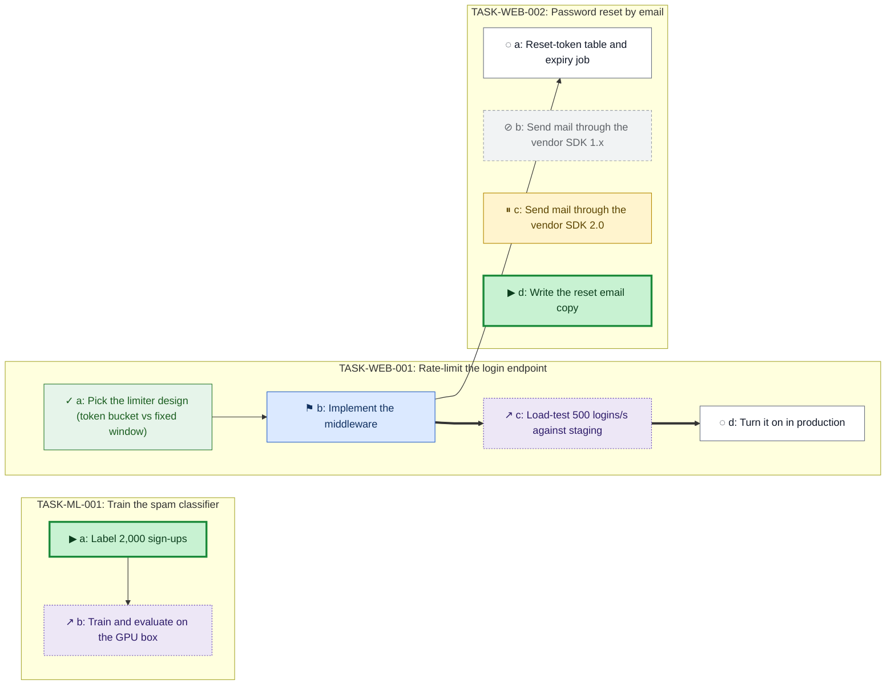

# Walkthrough: two worktrees, one queue

`sh examples/demo.sh` plays this whole page in a temp directory, and CI runs it on every push.

## Set up a clone

In each clone of your repository:

```console
crossbox init                          # creates .crossbox/ and a starter config
crossbox doctor install-merge-driver   # claims.yaml merges as a union, not a conflict
crossbox doctor install-hook           # pre-commit: refuse damaged task files
```

`init` also adds `.crossbox/claims.yaml merge=crossbox-claims` to `.gitattributes`;
commit that. The merge-driver and hook installers write per-clone git
configuration, so run them once in every clone (worktrees of one clone share it).

> **Trust boundary.** `crossbox ready` (and `plan`, `near-done`, `graph`, `done`,
> `status --summary --ready`) runs the shell commands in
> `.crossbox/needs-registry.yaml` `probe:` fields. That file comes with the
> repository, so in a clone you did not write, read it first or pass `--no-probes`. See [SECURITY.md](../SECURITY.md).

## Two agents, two worktrees

```console
$ crossbox init
$ cat > .crossbox/config.yaml <<'EOF'
prefix: TASK
machines:
  laptop:      {provides: [docker]}
  workstation: {provides: [gpu, docker]}
EOF
$ crossbox new "Parser rewrite" -d api -p high
created TASK-API-001  (.crossbox/queue/TASK-API-001.yaml)
next: crossbox add TASK-API-001 "first step title"
$ crossbox add TASK-API-001 "Write tests for the new grammar"
added TASK-API-001.a
$ crossbox add TASK-API-001 "Port the parser" -D a
added TASK-API-001.b
$ crossbox add TASK-API-001 "Benchmark on the GPU box" -t gpu -D b
added TASK-API-001.c
$ git add -A && git commit -m "queue" && git push
```

Step `c` targets `gpu`, which only the workstation provides, so on the laptop it is
"for other machines". Step `b` waits on `a`. Claim `a` and commit the claim:

```console
$ crossbox claim TASK-API-001.a
claimed CLM-laptop-001 -> TASK-API-001.a
This claim exists only in this tree until you commit and push .crossbox/claims.yaml.
$ git add -A && git commit -m "claim a"
```

Open a second worktree for a second agent. It sees the claim at once, through the
object store the worktrees share, without anything being pushed:

```console
$ git worktree add -b feature ../app-feature && cd ../app-feature
$ crossbox ready
READY on laptop (app-feature): top 0 of 0
  CLAIMED  TASK-API-001.a: CLM-laptop-001 (laptop/main)
ready 0 · gated 0 · claimed 1 · waiting 1 of 2 open step(s) workable here; 0 malformed; 1 for other machines
$ crossbox add TASK-API-001 "Document the grammar"
added TASK-API-001.d
$ git commit -am "doc step"
```

Back in the first worktree, adding a step would mint `d` a second time. The
origin guard sees `d` on the `feature` branch and refuses:

```console
$ cd ../app && crossbox add TASK-API-001 "Fix the lexer"
crossbox: origin guard: REFUSED: other branches hold step ids this file lacks:
  feature: d
  rebase or land first, then add (set CROSSBOX_SKIP_ORIGIN_GUARD=1 to override)
$ git merge feature && crossbox add TASK-API-001 "Fix the lexer"
added TASK-API-001.e
$ crossbox done TASK-API-001.a
hint: release CLM-laptop-001 when you are finished with it
done TASK-API-001.a
$ crossbox release --all-mine
released 1 of 1
```

## The queue as a graph

`crossbox graph` draws the dependency graph in Mermaid (it renders on GitHub when
pasted in a `mermaid` block), DOT (Graphviz) or JSON. This is
[`examples/sample-queue/`](../examples/sample-queue) as the laptop sees it, from
`CROSSBOX_MACHINE=laptop crossbox --root examples/sample-queue graph`. A test
regenerates it, so it cannot drift from the tool.



Each step carries its state as a colour and a marker: `✓` done, `⊘` skipped,
`▶` ready here, `⏸` gated, `⚑` claimed, `◌` waiting, `↗` for another machine, `✖`
malformed, `↻` in a cycle, `?` not evaluable. Thick arrows are the critical path
from [`plan`](plan.md). More: [views](views.md).

---
[README](../README.md) · [walkthrough](walkthrough.md) · [data model](data-model.md) · [reference](reference.md) · [claims](claims.md) · [guards](guards.md) · [readiness](readiness.md) · [plan](plan.md) · [views](views.md) · [closures](closures.md) · [lint](lint.md) · [doctor](doctor.md) · [configuration](configuration.md) · [plugin](plugin.md) · [agents](agents.md) · [known limits](limits.md) · [credits](credits.md)
